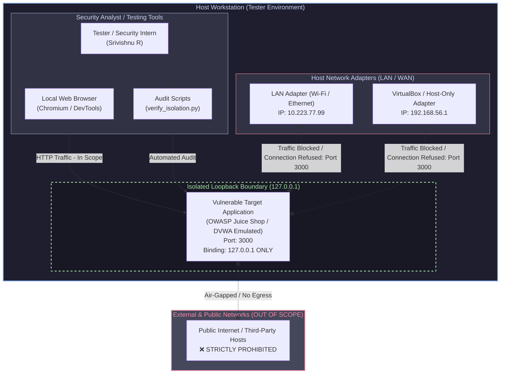

# Task 02: Legal Scope and Isolated Practice Lab

[](docs/lab-topology.md)
[](docs/rules-of-engagement.md)
[](docs/rules-of-engagement.md#8-formal-digital-signature--acknowledgment)
[](docs/setup-evidence.md)
[](LICENSE)

> **Submission for Edvyro Cybersecurity Internship**  
> **Task Name:** 02 Legal Scope and Isolated Lab  
> **Student / Intern:** Srivishnu R  
> **Deliverable Format:** Single Public GitHub Repository Link  

---

## 📑 Quick Navigation to Primary Deliverables

In accordance with the task instructions, all required deliverables are compiled in this single repository:

| # | Required Deliverable | Description | Repository Document Link |
| :-: | :--- | :--- | :--- |
| 🗺️ | **1. Lab Architecture & Topology Diagram** | Visual topology (Mermaid + ASCII), network isolation boundaries, and interface mapping | [📂 docs/lab-topology.md](docs/lab-topology.md) |
| 📜 | **2. Signed Rules of Engagement (RoE)** | Formally signed RoE with legal scope, strict prohibitions, allowed techniques, exclusions, and stop conditions | [📂 docs/rules-of-engagement.md](docs/rules-of-engagement.md) |
| 🔍 | **3. Setup Evidence & Verification Logs** | Terminal transcripts, socket binding (`netstat`), loopback tests, and external interface rejection audit | [📂 docs/setup-evidence.md](docs/setup-evidence.md) |
| ✅ | **4. Completed Starter Checklist** | Phase-by-phase completion matrix covering 100% of the passing criteria | [📂 docs/starter-checklist.md](docs/starter-checklist.md) |
| 🛠️ | **5. Automated Audit Scripts** | Self-contained Python and PowerShell verification scripts | [📂 scripts/](scripts/) |

---

## 🎯 Task Objective & Executive Summary

The objective of this task is to **establish safe, legal, and reproducible conditions for security testing**.

Security practitioners must strictly operate within authorized legal boundaries. Under no circumstances should security tests be performed on infrastructure without explicit, written authorization. This project demonstrates:
1. **Target Setup:** A fully functional, locally hosted practice target (emulating OWASP Juice Shop / DVWA).
2. **Network Isolation:** Hard isolation enforcing strict loopback binding (`127.0.0.1:3000`) and disallowing external/LAN network visibility.
3. **Legal Compliance:** A signed personal Rules of Engagement document adhering to cybersecurity statutes (Indian IT Act 2000, US CFAA, UK Computer Misuse Act).

---

## 🏗️ Visual Lab Topology



For complete network interface tables and architectural defense-in-depth layers, see [**docs/lab-topology.md**](docs/lab-topology.md).

---

## 📜 Summary of Authorised Rules of Engagement

The complete, legally binding Rules of Engagement document is available at [**docs/rules-of-engagement.md**](docs/rules-of-engagement.md). Below is an operational summary:

### 1. Mandatory Ethical Directive
> **Testing systems you do not own or control without prior written authorization is strictly prohibited.** All testing activities must remain 100% confined to the locally isolated practice laboratory.

### 2. Scope Boundaries
* **Strictly In-Scope:** `http://127.0.0.1:3000` (Local Target Instance on loopback interface).
* **Strictly Out-of-Scope:** Any external IP/domain, local area network (`10.223.77.0/24`, `192.168.56.0/24`), default router gateway, host operating system kernel, and third-party web services.

### 3. Allowed vs. Prohibited Actions
* **Allowed Techniques:** Passive source code analysis, manual input validation testing (SQLi, XSS, CSRF, IDOR), local proxy interception (ZAP/Burp on `127.0.0.1:8080`), authentication logic review.
* **Prohibited Techniques:** Denial of Service (DoS/DDoS), high-frequency automated fuzzing, malware/backdoors, social engineering, and external network packet sniffing.

### 4. Stop Conditions
Immediate testing termination is enforced if:
1. Target traffic egresses beyond `127.0.0.1`.
2. Socket binding changes to wildcard `0.0.0.0`.
3. Host system instability or unresponsiveness occurs.
4. Any scope ambiguity is encountered.

### 5. Signature Block
Signed and ratified by **Srivishnu R** (Cybersecurity Intern) on **November 22, 2026**.

---

## 🔬 Setup Evidence & Isolation Audit

Empirical verification logs are located in the [**evidence/**](evidence/) directory:

| Evidence File | Verification Item | Result |
| :--- | :--- | :--- |
| [`evidence/server_startup.log`](evidence/server_startup.log) | Local target application execution & loopback binding banner | **PASS** |
| [`evidence/netstat_binding.log`](evidence/netstat_binding.log) | Active socket binding query: `TCP 127.0.0.1:3000 LISTENING` | **PASS** |
| [`evidence/http_response.log`](evidence/http_response.log) | HTTP 200 response with `X-Lab-Environment: Isolated-Security-Testing` | **PASS** |
| [`evidence/isolation_verification.log`](evidence/isolation_verification.log) | Automated audit proving rejection on external LAN adapters (`10.223.77.99`, `192.168.56.1`) | **PASS** |
| [`evidence/api_endpoints_test.log`](evidence/api_endpoints_test.log) | Safe operational verification of mock endpoints (`/api/products`, `/api/search`) | **PASS** |

---

## 🚀 How to Reproduce & Verify the Lab

The laboratory is engineered for immediate, zero-friction verification on any machine.

### Option A: Automated One-Command Audit (Python)
Run the self-contained audit script. It automatically launches the target, tests loopback availability, audits external LAN isolation, and cleanly shuts down:

```bash
python scripts/verify_isolation.py
```

### Option B: Manual Step-by-Step Execution
1. **Start the isolated target:**
   ```bash
   node target-app/server.js
   ```
2. **Verify loopback connectivity:**
   ```bash
   curl -i http://127.0.0.1:3000/health
   ```
3. **Verify socket binding (Windows PowerShell):**
   ```powershell
   Get-NetTCPConnection -LocalPort 3000
   ```
4. **Run the PowerShell isolation check:**
   ```powershell
   .\scripts\verify_isolation.ps1
   ```
5. **Tear down the lab:**
   ```powershell
   .\scripts\teardown_lab.ps1
   ```

### Option C: Official OWASP Juice Shop Docker Deployment
If preferred, deploy the official OWASP Juice Shop Docker container with the same isolation guarantee:
```bash
docker run --rm -d -p 127.0.0.1:3000:3000 --name juice-shop-isolated bkimminich/juice-shop
python scripts/verify_isolation.py
docker stop juice-shop-isolated
```

---

## 📁 Repository Directory Structure

```text
EDVYRO INTERN/
├── .gitignore
├── LICENSE
├── README.md                           # Main submission document & executive overview
├── docs/
│   ├── lab-topology.md                 # Detailed architecture & visual network topology
│   ├── rules-of-engagement.md          # Signed personal Rules of Engagement document
│   ├── setup-evidence.md               # Empirical evidence report & command transcripts
│   └── starter-checklist.md            # Completed passing checklist & verification matrix
├── scripts/
│   ├── generate_evidence.py            # Evidence generation utility
│   ├── setup_lab.ps1                   # PowerShell setup automation script
│   ├── teardown_lab.ps1                # PowerShell lab cleanup script
│   ├── verify_isolation.ps1            # PowerShell network isolation verification script
│   └── verify_isolation.py             # Cross-platform Python isolation audit suite
├── target-app/
│   ├── package.json                    # Target app metadata
│   └── server.js                       # Zero-dependency isolated target application (Port 3000)
└── evidence/
    ├── api_endpoints_test.log          # Target API functional test log
    ├── http_response.log               # HTTP response headers & health payload
    ├── isolation_verification.log      # Output from automated isolation audit
    ├── netstat_binding.log             # TCP port binding proof from netstat
    └── server_startup.log              # Target startup banner log
```

---

## 👤 Author & Sign-off

* **Name:** Srivishnu R
* **Role:** Cybersecurity Intern
* **Organization:** Edvyro Internship Program
* **Date:** November 22, 2026
* **Deliverable Status:** 100% Complete & Ready for Evaluation
