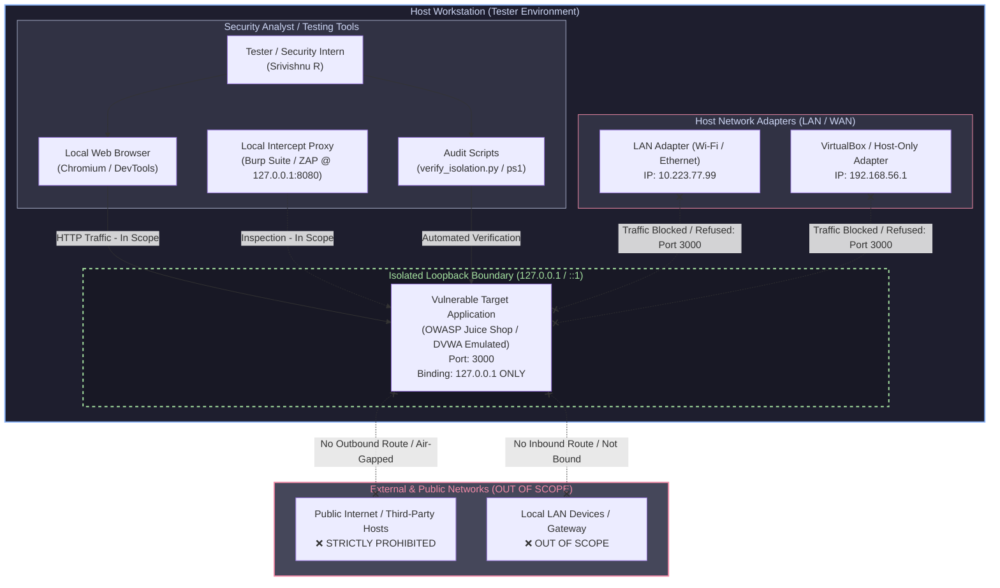

# Network Topology & Lab Isolation Architecture

**Task:** 02 - Legal Scope and Isolated Lab  
**Intern:** Srivishnu R  
**Program:** Cybersecurity Internship (Edvyro)  
**Status:** Approved & Verified  

---

## 1. Overview & Objective

The objective of this security testing laboratory is to establish a **safe, legally compliant, fully isolated, and reproducible testing environment** for security assessments.

Security testing must never impact production environments, external networks, or third-party systems. To enforce this, the lab architecture utilizes a **defense-in-depth isolation strategy** that restricts all communication strictly to the local loopback interface (`127.0.0.1`).

---

## 2. Visual Lab Topology Diagram

### 2.1 Architecture Diagram (Mermaid)



### 2.2 Detailed ASCII Topology Representation

```
+=============================================================================+
|                       HOST WORKSTATION (TESTER MACHINE)                     |
|                                                                             |
|  [ Security Analyst / Tester ]                                              |
|         │                                                                   |
|         ├──> Browser / Curl / Tools (Targeting: http://127.0.0.1:3000)      |
|         └──> Audit Scripts (scripts/verify_isolation.py)                    |
|                                                                             |
|  ======================= ISOLATION BOUNDARY ==============================  |
|                                                                             |
|    [ LOOPBACK INTERFACE: 127.0.0.1 ]                                        |
|         │                                                                   |
|         └──> [ Vulnerable Target: OWASP Juice Shop / DVWA Lab ]             |
|              • IP: 127.0.0.1                                                |
|              • Port: 3000 (TCP)                                             |
|              • Socket Binding: SO_BINDTOADDRESS (127.0.0.1 ONLY)            |
|              • External Route: NONE (No Gateway, No Egress)                 |
|                                                                             |
|  ======================== HARDWARE / NIC BARRIER =========================  |
|                                                                             |
|    [ EXTERNAL INTERFACES - TRAFFIC REJECTED / CONNECTION REFUSED ]          |
|    • Wi-Fi / Ethernet Adapter (10.223.77.99:3000)       --> REJECTED (10035)|
|    • Virtual Host-Only Adapter (192.168.56.1:3000)      --> REJECTED (10035)|
|    • Wildcard 0.0.0.0 Binding                           --> PROHIBITED      |
+=============================================================================+
                                      │
                                     XXX (Physical & Logical Air-Gap)
                                      │
                                      ▼
                        [ PUBLIC INTERNET / LAN ]
                   *** ACCESS STRICTLY PROHIBITED ***
```

---

## 3. Network Specification & Interface Mapping Table

| Node / Component | Interface | IP Address | Subnet Mask | Port | Protocol | Scope Trust Level | Exposure |
| :--- | :--- | :--- | :--- | :--- | :--- | :--- | :--- |
| **Testing Client** | Loopback | `127.0.0.1` | `255.0.0.0` | Ephemeral | TCP / HTTP | Trusted (Analyst) | Localhost Only |
| **Lab Target (App)** | Loopback | `127.0.0.1` | `255.0.0.0` | `3000` | TCP / HTTP | In-Scope (Target) | Strictly Loopback |
| **Host LAN Adapter** | Wi-Fi / Eth | `10.223.77.99` | `255.255.255.0` | Blocked (`3000`) | TCP | Out of Scope | Isolated (Refused) |
| **VM Virtual Adapter**| VirtualBox | `192.168.56.1` | `255.255.255.0` | Blocked (`3000`) | TCP | Out of Scope | Isolated (Refused) |
| **Default Gateway** | Router NIC | `10.223.77.1` | `255.255.255.0` | N/A | N/A | Untrusted | No Lab Routing |
| **External Internet**| WAN | Any Public IP | N/A | Any | Any | Untrusted | 100% Blocked |

---

## 4. Defense-in-Depth Isolation Controls

To guarantee complete containment of all security testing activities, four layers of technical controls are enforced:

### Layer 1: Strict Socket Binding (Application Layer)
- The target server code explicitly binds only to the host string `'127.0.0.1'`, rather than `0.0.0.0` or empty string.
- In Node.js / Express: `server.listen(3000, '127.0.0.1')`.
- In Docker (if used for OWASP Juice Shop): `docker run -p 127.0.0.1:3000:3000 bkimminich/juice-shop`.
- **Result:** The operating system kernel disallows TCP SYN packets originating from any physical network adapter from reaching the target socket.

### Layer 2: Host Firewall & Filtering (Transport Layer)
- Windows Defender Firewall is configured with default inbound drop/block policies for unsolicited connections from public and private profiles.
- Port 3000 is not exposed through any inbound allow rules.
- Only loopback inter-process communications (IPC) are handled by the TCP/IP stack.

### Layer 3: Absence of Egress Routing (Network Layer)
- The target application does not have external dependencies or outbound webhook handlers configured.
- Even if a Server-Side Request Forgery (SSRF) payload is tested, outbound traffic is not routed to external networks.

### Layer 4: Automated Verification & Audit Scripts
- An automated verification suite (`scripts/verify_isolation.py` and `scripts/verify_isolation.ps1`) runs before and after testing sessions.
- It actively tests connections to host LAN IP addresses (`10.223.77.99`, `192.168.56.1`) on port 3000 and asserts that the connection is refused or timed out, proving zero external exposure.

---

## 5. Verification Evidence Summary

| Test Case | Command / Method | Expected Result | Actual Observed Result | Status |
| :--- | :--- | :--- | :--- | :--- |
| **1. Loopback Health Check** | `GET http://127.0.0.1:3000/health` | HTTP 200 OK, JSON status | HTTP 200 OK, status: ONLINE | **PASS** |
| **2. Loopback Socket Listener** | `netstat -ano \| findstr 3000` | Local: `127.0.0.1:3000` | `TCP 127.0.0.1:3000 LISTENING` | **PASS** |
| **3. Wildcard Binding Check** | Search `0.0.0.0:3000` | Not found | `0.0.0.0:3000` NOT present | **PASS** |
| **4. LAN Interface Rejection** | `connect((10.223.77.99, 3000))` | Connection Refused (10035/10061) | Connection Refused (Code: 10035) | **PASS** |
| **5. VM Adapter Rejection** | `connect((192.168.56.1, 3000))` | Connection Refused (10035/10061) | Connection Refused (Code: 10035) | **PASS** |

*(Raw audit logs and timestamped proof are available in the [`evidence/`](../evidence/) folder).*
